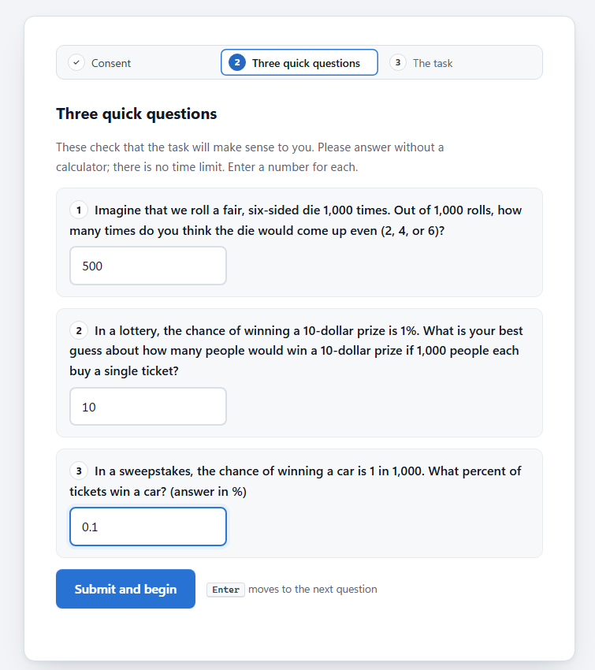
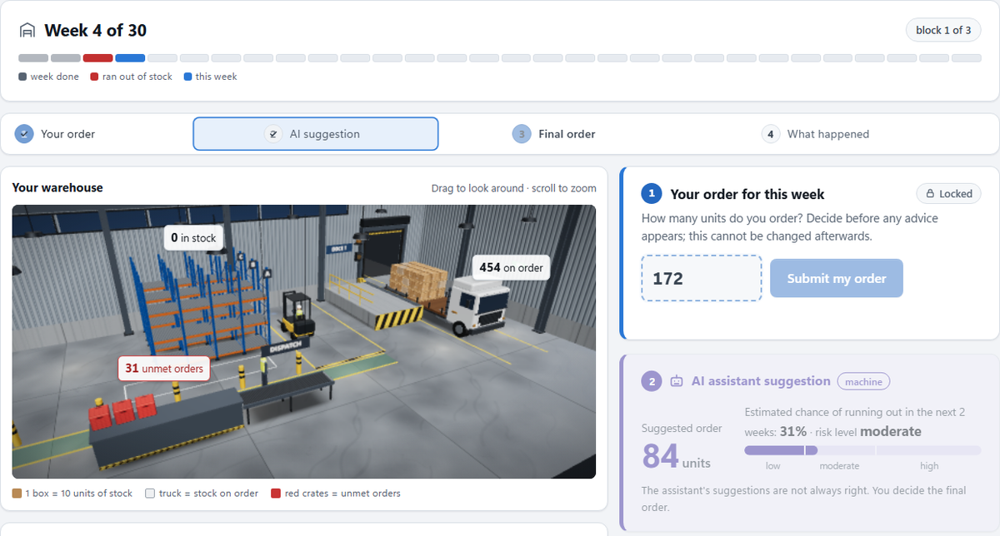
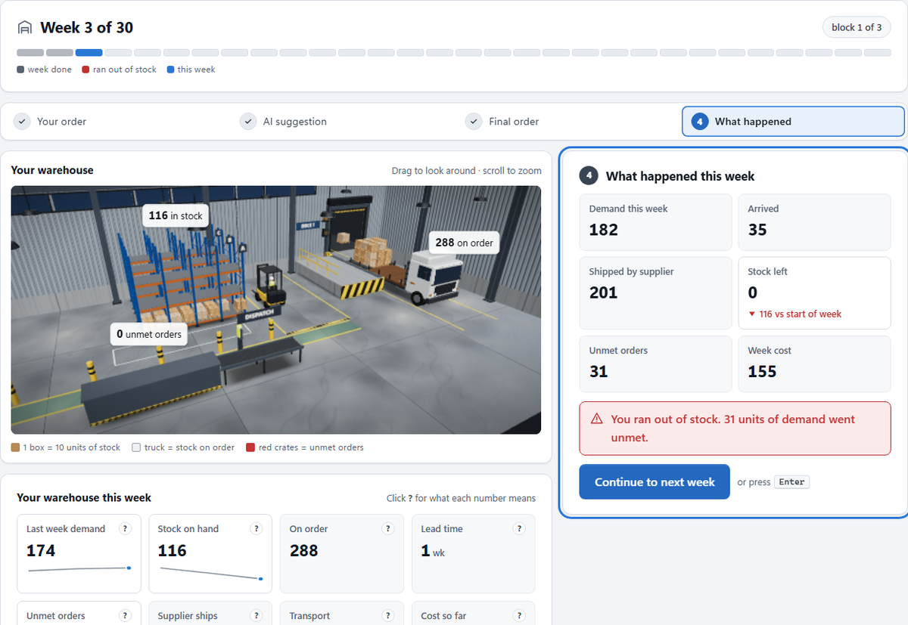
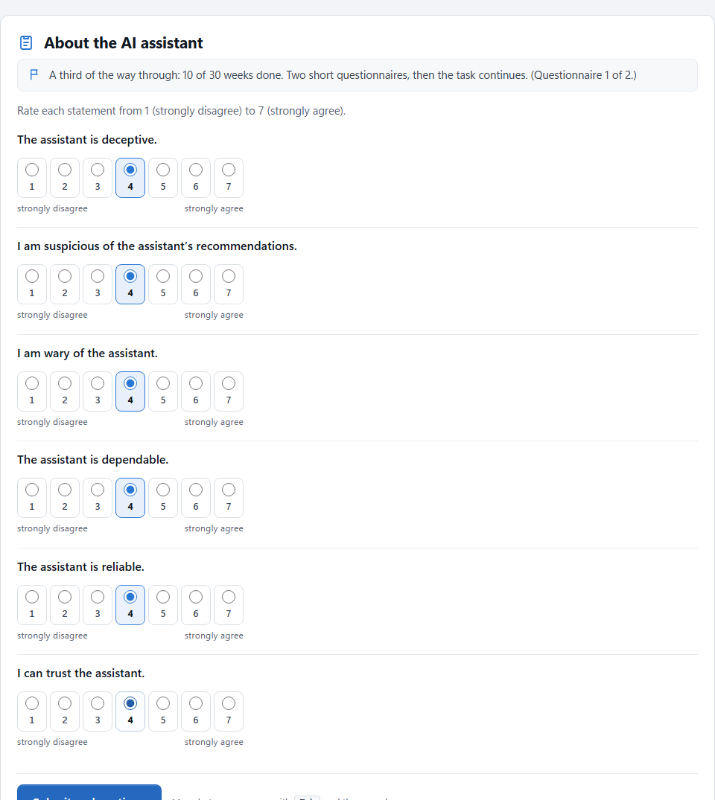
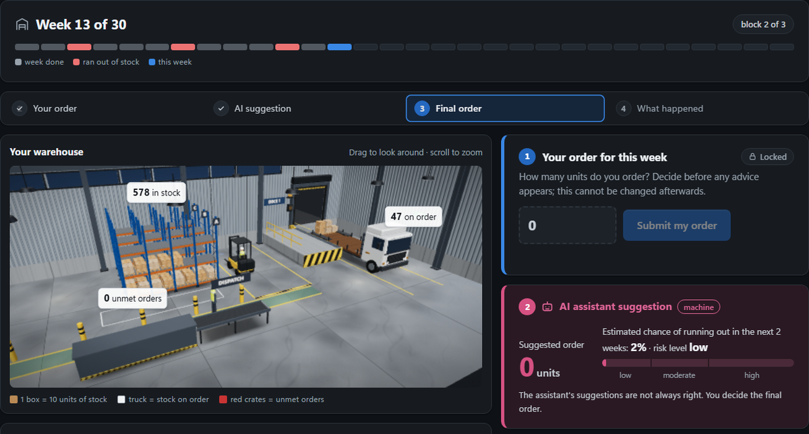
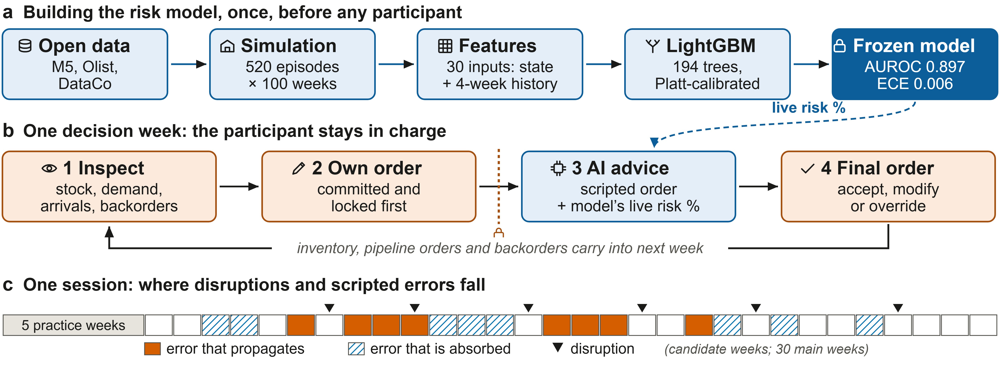
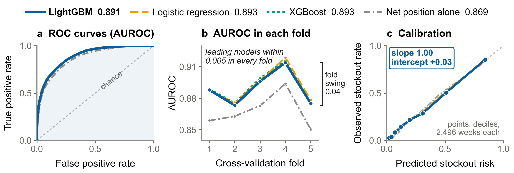
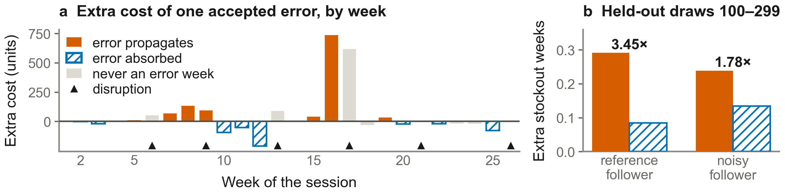

# Reliance Under Disruption

Code, models and results for the AHFE 2027 paper *Human–AI Collaboration in Supply Chains: A
Framework for Resilient Decision Making Under Disruption* (Málaga, 26–30 July 2027).

Participants manage a simulated warehouse for 30 weeks. Each week they commit their own order,
then see an AI assistant's suggestion (a scripted recommended order plus a live, calibrated
LightGBM stockout-risk estimate), then enter a final order. The study asks whether reliance on
AI depends on **where** its errors fall (weeks where a bad order propagates vs weeks where it is
absorbed), not only on **how often** it errs.

- **Every result and where it comes from:** [`docs/RESULTS.md`](docs/RESULTS.md)
- **Figures:** [`figures/`](figures/) (each made by a script in this repository from a saved result file).
  The manuscript itself is not included until it is published.
- **Live study:** https://reliance-study.onrender.com (data collection, see the note below)

---

## For reviewers: trying the study

**Please do not start a session on the live site.** It is the data-collection instance, so every
session started there creates a study record. Run your own copy instead; it takes a minute and
writes only to a local throwaway database:

```bash
pip install -r requirements.txt
python src/interface/app.py --db demo.sqlite      # then open http://127.0.0.1:8000
```

`--db` points the app at its own SQLite file and ignores any production database URL.

**Answers for the screens you will meet:**

| Screen | What to enter |
|---|---|
| Numeracy screener (three items, 2 of 3 needed to continue; Schwartz et al., 1997) | die rolled 1,000 times, how many even: **500** · lottery with 1 % chance, 1,000 tickets: **10** · 1 in 1,000 chance, what percent: **0.1** |
| Trust questionnaire (six items, 1–7, after each 10-week block) | any rating; there are no right answers |
| Workload questionnaire (NASA-TLX, five subscales, 1–20) | any rating; there are no right answers |
| Perceived reliability (end of session) | any number from 0 to 100 |
| Weekly orders | any whole number; the AI suggestion and risk estimate appear after you lock your own order |

A scripted end-to-end session also runs without a browser:

```bash
python src/interface/app.py --dry-run --db demo.sqlite
```

---

## The study in pictures

| | |
|---|---|
|  |  |
| **Numeracy screener**, before condition assignment (answers shown) | **One decision week**: the participant's own order is locked, then the AI suggestion and its live stockout-risk estimate appear |
|  |  |
| **What happened**: the week's outcome, here a stockout | **Trust questionnaire** after each 10-week block |



*Dark mode, mid-session (week 13 of 30).*

**How it works.** The framework (left), the risk model's validation (middle) and the error-placement
design (right); full-size files are in [`figures/paper/main_text/`](figures/paper/main_text/).





---

## Project status

| Area | State |
|---|---|
| Simulation | ✅ Single-echelon inventory simulation replaying real Walmart M5 demand; property-tested; benchmarked against closed-form base-stock theory (`src/benchmark_base_stock.py` → `results/twin_benchmark.json`) |
| AI component | ✅ Live LightGBM risk model (AUROC 0.897; 0.902 on unseen session demand); Platt-calibrated and frozen. Recommended orders are scripted so recommendation accuracy is exact |
| Error design | ✅ All errors are under-orders, placed on weeks chosen by measured consequence and validated on held-out simulations (`src/placement_design.py` → `results/placement_design.json`) |
| Participant app | ✅ Information sheet, numeracy screener, two-stage ordering, questionnaires, debrief, withdrawal, desktop-only gate |
| Tests | ✅ `python -m pytest src/tests` (131 pass on SQLite; 23 more need a Postgres server) |
| Analysis scripts | ✅ `src/analysis/run_all.py` (registered models, exclusions, measures); recovers planted effects on simulated participants, none on the null set |
| Deployment | ✅ Live on Render with Neon Postgres: https://reliance-study.onrender.com |
| Pre-registration | ✅ Registered on OSF (protocol text in `docs/OSF-PREREGISTRATION.md`) |
| Data collection | ✅ Running on the live study site |
| Paper | ✅ AHFE 2027 paper in the official template (manuscript not included in this repository) |

---

## The model in one paragraph

LightGBM predicts P(stockout within 2 weeks) from the warehouse state. On the
simulator it is **top tier but not the outright winner**: AUROC 0.891, tied
with logistic regression (0.893) and XGBoost (0.893), and significantly better
than six deep-learning models including PatchTST (+0.034); neural models got
*worse* from 50 to 100 epochs (overfitting). Externally it is validated on
Walmart M5 (a separate per-store forecaster scoring between the **38th and 39th
of 5,507 teams**), on the Ntakolia et al. (2021) backorder benchmark (90.3 % with
the published protocol, against 87.78–88.85 % reported), and on DataCo/Olist (Li 2026). Details: [`lightgbm-pivot/OVERVIEW.md`](lightgbm-pivot/OVERVIEW.md).

---

## Directory

```
src/                      study code
  simulator.py            warehouse simulator          policy.py      correct order Q*, δ = ±60
  live_model.py           live LightGBM risk model     demand_source.py  M5 demand replay
  placement_design.py     design v2 week selection     propagation_recovery.py  bias → 4.47 weeks
  power_analysis.py       power at 35/cell             leak_check.py  does the screen leak errors?
  interface/              participant web app (Flask)
    app.py                server, sessions, recovery, desktop check, /healthz
    advice.py             reliability schedule, errors, risk display (design v1/v2)
    world.py              shared M5 demand + session order cap
    db.py, schema.sql, schema_postgres.sql    SQLite (local) / Postgres (cloud)
    numeracy.py, withdraw.py, verify_log.py
    templates/            index (consent, screener, desktop gate), task, info sheet
  analysis/               pre-registered analysis: load, exclusions, measures, confirmatory, exploratory, run_all
  tests/                  pytest suite (131 + 23 that need Postgres) + e2e_desktop_gate.py (browser)
models/                   live_risk_lgbm.txt + live_risk_meta.json
lightgbm-pivot/           model benchmarks, OVERVIEW.md, report.html
demo/                     run_demo.py (live browser demo; --headed to watch)
  narrated/               make_narrated_demo.py (builds a narrated demo video locally)
figures/paper/            paper figures (PNG + SVG) and CAPTIONS.md
deploy/                   deployment guide (Render + Neon; see render.yaml and the Dockerfile)
.github/workflows/        ci.yml (tests on every push)
docs/                     RESULTS.md (every result and its source), OSF pre-registration, README images
data/processed/           fitted parameters, M5 demand cache (needed at runtime)
data/raw/                 M5, Olist, DataCo, Kaggle backorder (not included; see data/README.md)
results/                  design checks, power analysis, earlier model results
archive/patchtst/         retired PatchTST work (kept for the record)
```

## Common commands

```bash
python -m pytest src/tests -q                          # all tests
python src/interface/app.py --port 8000 --db demo/output/play.sqlite3   # play locally
python demo/run_demo.py --headed                       # watch a scripted session
python demo/run_demo.py --slow                         # watch it at human speed (tour, typing, 3D animation)
python src/interface/app.py --dry-run --db /tmp/d.sqlite3 && \
  python src/interface/verify_log.py --db /tmp/d.sqlite3 --participant DRYRUN-01
python src/live_model.py                               # retrain the live model (changes what participants see)
python src/placement_design.py                         # re-validate the error weeks
docker build -t reliance-study:local .                 # production image
python src/analysis/run_all.py                         # analysis on the simulated datasets
python demo/narrated/make_narrated_demo.py             # rebuild the narrated video (~12 min, overwrites in place)
```

## Environment notes

Python 3.13 (use `python -m pip`, not bare `pip`); PyTorch CUDA build for the
archived neural models; LightGBM **4.7.0** must match the version that trained
`models/live_risk_lgbm.txt`. Flask caches templates: restart the server after
editing HTML. Production runs exactly **one** process (sessions live in memory).

## Licence

Code is released under the [MIT Licence](LICENSE). The vendored three.js copy under
`src/interface/static/vendor/three/` keeps its own MIT licence. Third-party datasets (Walmart M5, Olist,
DataCo) are not redistributed; `data/README.md` explains how to obtain them.
