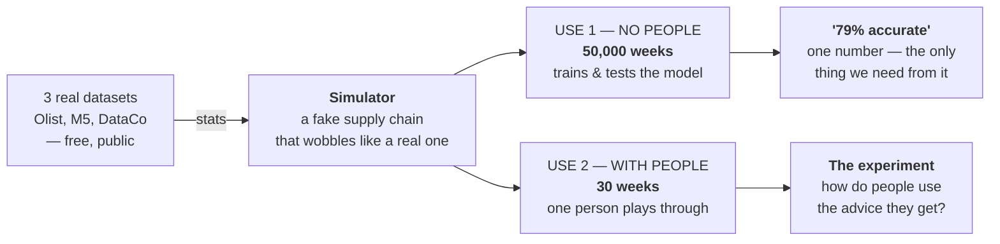
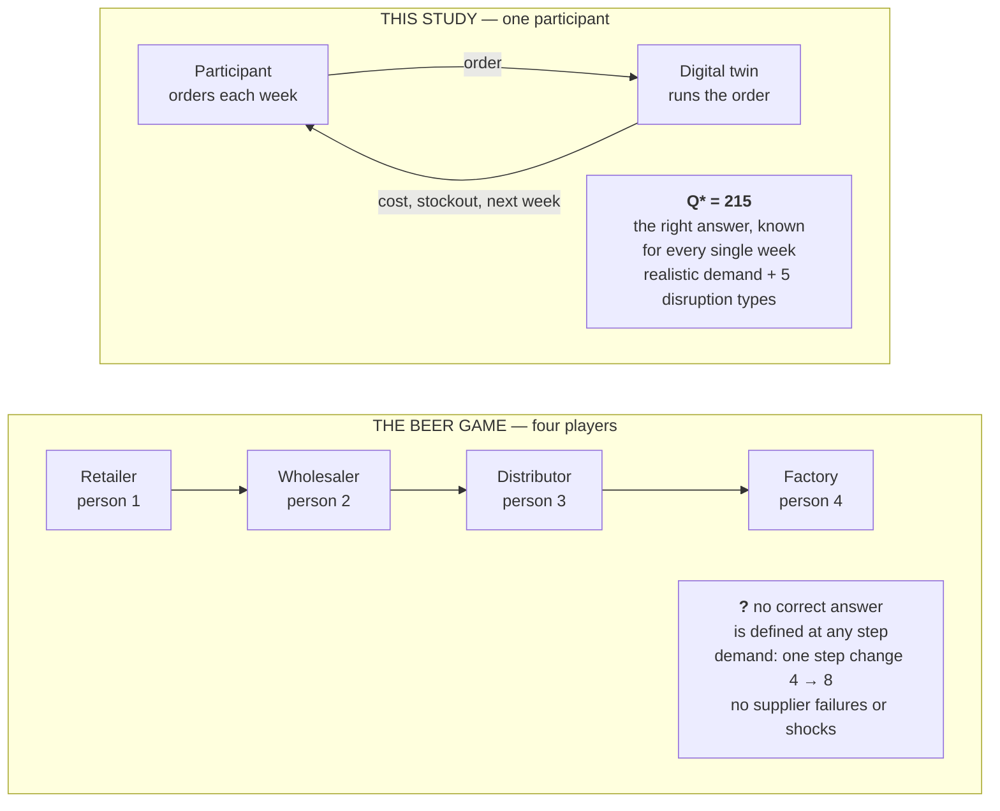
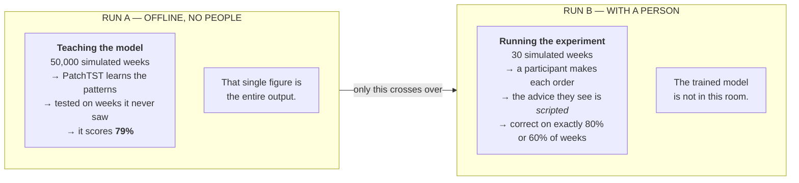

# Patches, Not Weeks — How the Model Works

> **Archived:** 17 September 2026 · **Live version (animated):** https://claude.ai/artifact/F2w2GomeXUC76HzSg2ShHS
> Companion to [the results record](docs/RESULTS.md).

How the forecasting model actually works — from three public datasets, through PatchTST, to the single number a human being sees on screen. No machine-learning background assumed.

---

## The whole thing in one sentence

The model looks at the last 48 weeks of a supply chain and answers one question: **what is the chance we run out of stock in the next few weeks?** Everything else exists to produce that number honestly — and then to find out how people react to it.



*Real data sets the dials on a simulator; the simulator is then used twice, for two different jobs. Keeping those two uses separate is the thing most worth understanding — Step 7 comes back to it.*

---

## Step 1 — Where the numbers come from

We do not have a real supply chain to study. So we build a fake one that behaves like a real one.

Three public datasets are downloaded, and from each we take only the *statistics* — not the data itself:

| From | We take | Which gives us something like |
|---|---|---|
| **Olist** (99k Brazilian orders) | How late deliveries usually run | orders arrive 1–2 weeks late, occasionally 4 |
| **M5** (Walmart daily sales) | How much demand wobbles | avg 140 units/week, swings ±35 |
| **DataCo** (180k order records) | How often things go wrong | ~55 % of shipments hit a delay |

Then we write a small program — the simulator — that invents a supply chain using those numbers. It is fake, but it wobbles the way real ones wobble. That is what makes it defensible to a reviewer.

---

## Step 2 — What one week of data looks like

Every simulated week, the program writes down eight numbers:

```
Week 34
  demand 152      inventory 310     on order 120     lead time 2
  backorders 0    supplier 0.91     transport OK     disruption no
```

Let it run for about 50,000 weeks and you have a long spreadsheet: 50,000 rows, eight columns.

And here is the part that matters. **Because we built the simulator, we know what happened next.** So every row can be labelled: *did a stockout follow within four weeks — yes or no?* That label is what the model learns to predict.

> **Why not just use real data.** Real company data tells you what *happened*. It never tells you what the *right decision would have been*. Our study needs a correct answer for every single week, to judge whether a person's order was good or bad. Only a simulator can give us that.

---

## Step 3 — Which simulator, and why not the beer game

The obvious candidate is the **Beer Distribution Game** — the classic MIT supply-chain simulation, and still the best-known teaching tool in the field. We cite it, but we do not use it.

The decisive reason is that **it has no correct answer.** It was built to show how orders swing wildly up and down as they pass along a chain, not to judge whether any single order was right. Our entire study depends on knowing the right answer every week, so we can tell a good decision from a bad one. It is also a four-player game where we need one participant, and its customer demand is a single step change rather than realistic week-to-week wobble with disruptions.



*We still cite the beer game: it is the classic proof that one ordering decision ripples into later weeks — which is exactly our point. We just need a task that also tells us what the right order was.*

So instead we build on **OR-Gym**, a published library of inventory simulations. It already contains the standard ordering rule we use as our correct answer, and it gets the stock-and-backorder bookkeeping right — which matters, because that arithmetic is easy to get subtly wrong and the mistake would quietly corrupt every cost figure in our results.

We add the disruption calendar on top, and write the participant screen ourselves. Chain stays short — supplier, warehouse, customer — so one person can hold it in mind.

---

## Step 4 — The one idea behind PatchTST

This is the only real concept needed, and the paper's title gives it away: *"A Time Series is Worth 64 Words."*

Imagine reading a sentence **letter by letter**: `d — e — m — a — n — d`. Each letter alone means nothing. Now read it **word by word**: `demand`. Same information, but now it carries meaning.

> Older models read a time series one week at a time — letter by letter. **PatchTST reads it in chunks of weeks — word by word.**

A single week's demand of 152 tells you almost nothing. But eight weeks together have a *shape*: "demand was climbing while inventory was falling." The shape is the signal. A chunk of weeks is called a **patch**, which is where the model gets its name.

```
THE OLD WAY — one week at a time
│▁▂▁▃▂▄▃▅▄▆▅▇▆█▇█▇█▇▆▇▅▆▄▅▃▄▂▃▁▂▁▂▃▂▄▃▅▄▆▅▃▄▂▃▁▂▁
└─ week 1 ────────────────────────────── week 48 ─┘
   48 separate things to compare — expensive, and each one alone is noise

PATCHTST — eight weeks at a time, sliding four
[── patch 1 ──]                          weeks 1–8
      [── patch 2 ──]                    weeks 5–12  (slid along by 4)
            [── patch 3 ──]              weeks 9–16
                    · · ·
                            [─ patch 11 ─]  weeks 41–48
   11 things to compare — cheaper, and each patch has a shape
   the model can recognise
```

*In the live version this figure is animated: the 8-week window steps along the 48 bars through all 11 positions.*

### What the model does, step by step

| Stage | What happens | Size |
|---|---|---|
| Input | Last 48 weeks, 8 variables each | 48 × 8 |
| **Cut into patches** | Chunks of 8 weeks, sliding 4 at a time | 11 patches |
| Summarise | Each patch of 8 numbers becomes a 64-number summary | 11 × 64 |
| Compare | Every patch is compared with every other patch | 11 × 11 |
| Answer | One probability of a stockout ahead | 1 number |

That "compare every patch with every other patch" stage is called **attention**. In plain terms, the model learns statements like: *"the patch covering weeks 12 to 20 looks very like the pattern that appeared just before the last three stockouts."* That is how it notices a problem building up slowly, several weeks before it bites.

One last detail: the eight variables are each read *separately*, using the same learned settings. Demand gets patched and read on its own, inventory on its own, and so on. It sounds wrong, but it works better than mixing them together.

---

## Step 5 — Turning one answer into a confidence

The model gives back a single number — say `0.82`. But how sure is it?

There is a neat trick for this. Run the very same input through the model 50 times, and each time randomly switch off a few parts of the network. You get 50 slightly different answers.

```
CONFIDENT — the runs agree              UNSURE — the runs disagree
                    ░▒█▓▒░                  ░  ▒ ░  ▓ ░ ▒  ░ ▒  ░
0 ──────────────────┼────── 1           0 ──┼──────┼────┼─────── 1
                 all near 0.82              average lands at 0.47
              "82% — and I mean it"       "47% — but I'm guessing"
```

Average = your risk number. Spread = how much to believe it. **Both sides could report a single number and look equally authoritative — which is exactly the problem.**

---

## Step 6 — Checking the number isn't lying

This step matters more in our study than in most, and it is easy to skip.

We are going to **show a human being the words "Shortage risk: 82 %"**. So that figure had better be true. The check is simple: gather every occasion the model said "about 80 %" and ask whether a stockout actually followed about 80 % of the time.

```
what actually happened
100% ┤                              ╱  ← honest (perfect diagonal)
     │                          ╱
     │                      ╱ ╱
 60% ┤· · · · · · · ·●  ╱          ● the model's real curve:
     │              ╱ ╱              says 80%, right only 60%
     │          ╱ ╱                  — it sags below the diagonal
   0 └──────────────┼──────────  100%
                 said 80%      what the model said
```

**Why this breaks the experiment.** Our study measures how people respond to risk figures. If the figures are wrong, we are measuring reactions to a lie, and the result means nothing.

*Fix:* a rescaling step (Platt scaling or isotonic regression) that pulls the curve back onto the diagonal before we show anyone.

---

## Step 7 — What the model is actually for

This is where people get tripped up, so plainly:

> **The model never talks to our participants.**

The simulator gets run twice, for two completely separate jobs.



**Why script the advice?** Because AI reliability is the thing being tested. A live model's accuracy drifts from week to week, and then we would no longer know what we were measuring.

So what did the 79 % buy us? Exactly this sentence: *"80 % represents a realistically achievable system, 60 % a degraded one"* — instead of picking numbers out of the air. That is the whole job of the machine-learning half of this project.

---

## Step 8 — The part that is actually the paper

Everything so far has been scaffolding. Here is the study itself — one week, as a participant experiences it:

```
Week 7.  Inventory 310.  Demand 152.  Supplier delayed.

  → "What will you order?"                you type  180
  → "AI: shortage risk 82%. Order 230."             230
  → "Final order?"                        you type  215

  → the simulator runs your 215
  → "Week 8: short by 40 units. Cost £1,240."
  → week 8 begins, carrying your shortfall forward
```

Three numbers per week — `180`, `230`, `215` — and from them we get everything that matters.

| From | We compute |
|---|---|
| Q_own + Q_AI + Q_final | **How much advice you took.** You moved 35 of the 50 units the AI suggested → weight 0.70 |
| Q_own vs the right answer | **Your skill without help**, with no AI involved |
| Week 8 onward | **And the part nobody has measured.** In every previous study of this kind, a poor decision costs you that one trial. Here, week 8 inherits your shortfall, week 9 is still recovering, week 10 may still carry backorders. One misplaced decision, several weeks of consequence. |

Multiply by 30 weeks and 70 participants: roughly 2,100 decisions to analyse.

**Why the participant is asked twice:** without their own order first, we could only record whether they clicked accept — not how far they moved, and not how good they were on their own.

---

## If you remember four things

1. The simulator is **calibrated from real data but generates our data** — because only then do we know the right answer for every week.
2. PatchTST reads time in **chunks, not single steps**. Words, not letters.
3. The trained model's only job is to **justify the 80 % and 60 % figures**. It never faces a participant.
4. The contribution is in Step 8. The model is supporting evidence; **the human behaviour is the paper.**
